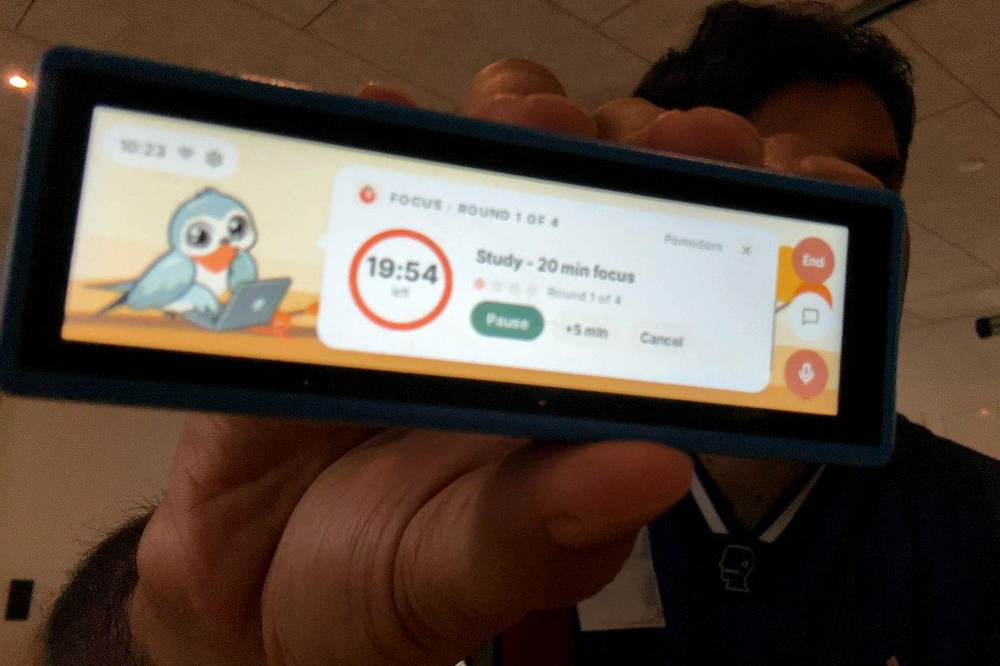
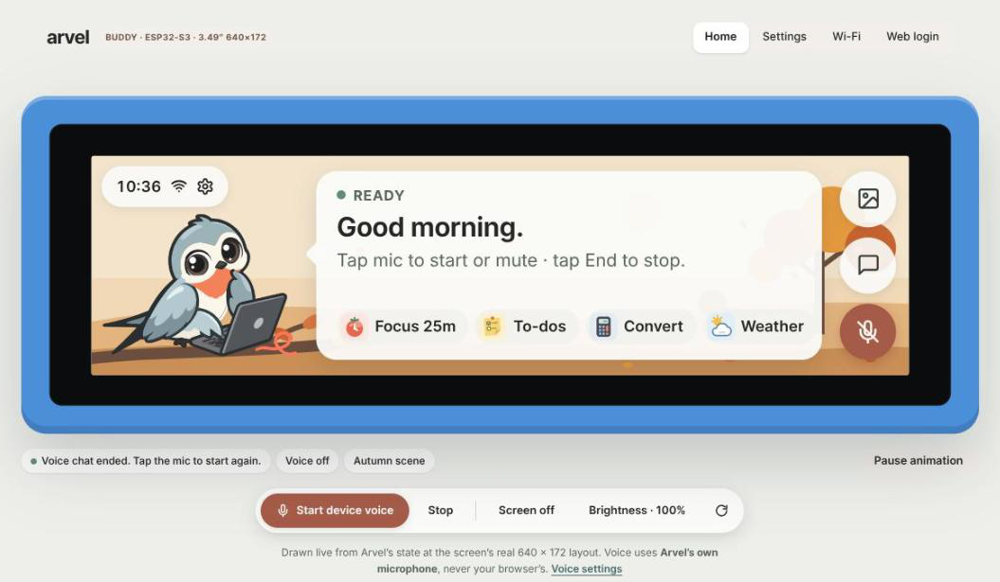
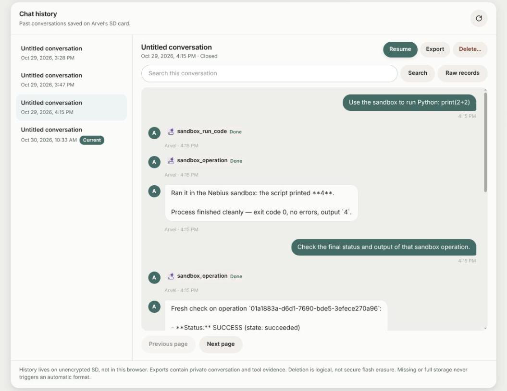

# Arvel

Arvel is a desk companion for the Waveshare ESP32-S3-Touch-LCD-3.49. It runs ESP-IDF firmware with a touchscreen interface, a SvelteKit web app, and the Rust [unravel-agent-runtime](https://github.com/unravelaidk/unravel-agent-runtime) on the board.



You can type or talk to it, set timers, keep notes, check the weather, and search the web. Cloud models handle conversation. The board runs the agent loop and device tools.

The owner web app shows Arvel's screen live and keeps your conversation history:





## Conversation modes

Choose a mode in Settings. Arvel does not switch modes when a provider fails.

| Mode | Requirements | How it works |
| --- | --- | --- |
| Text pipeline | An OpenAI-compatible text provider. Voice input also needs a transcription service. | The board sends text to the model and runs its tool calls. Voice input uses speech-to-text, and local eSpeak-NG reads replies aloud. |
| Codex subscription voice | A saved Codex account with live voice access. Device tools also need the configured text provider. | The board connects to Codex over WebRTC. No computer or voice bridge needs to stay running. |
| NVIDIA native speech | A separate NVIDIA-NemotronLabs-VoiceChat-11B deployment | One remote model handles speech and reasoning, with tool calls executed on the board. |

Local speech is an English formant voice, not neural TTS. Codex voice is experimental, depends on account eligibility, and may break if OpenAI changes its live transport. The NVIDIA deployment has not been GPU-tested in this project. See the [deployment guide](scripts/VOICECHAT_DEPLOYMENT.md) before using it.

## Build and board selection

You need ESP-IDF 5.5.3, Cargo/rustup, Node.js with npm, Python 3, and the Espressif Xtensa Rust toolchain named `esp`.

Install the Rust toolchain with [espup](https://github.com/esp-rs/espup).

```sh
espup install --std --targets esp32s3
```

Activate ESP-IDF and the environment script printed by espup. Keep Cargo on `PATH`; do not assume `~/.cargo/env` exists if Rust came from another package manager.

For a conventional ESP-IDF installation, use its standard activation script (adjust the installation path):

```sh
. "$HOME/.espressif/v5.5.3/esp-idf/export.sh"
```

For an Espressif Installation Manager (EIM) installation, use the activation script generated by EIM instead. This is the working setup on the submission build host:

```sh
. "$HOME/.espressif/tools/activate_idf_v5.5.3.sh"
function idf.py() {
    "$IDF_PYTHON_ENV_PATH/bin/python" "$IDF_PATH/tools/idf.py" "$@"
}
idf.py --version
rustc +esp --version
```

The function is for Bash automation: EIM supplies an `idf.py` alias, which noninteractive Bash does not expand. Verify that the version is **ESP-IDF v5.5.3**. On this host, the standard `export.sh` failed because its Python/tool-root/constraints layout differed from EIM's; this is not a general failure of the standard installer. In a read-only build sandbox, EIM's optional final IDE-selection sync can return nonzero even though the environment is set; the explicit version check and build, not that status alone, establish readiness.

From the repository root, install the frontend dependencies and create a private configuration if one does not already exist.

```sh
npm --prefix interface ci
test -e sdkconfig.local || cp sdkconfig sdkconfig.local
idf.py -D SDKCONFIG=sdkconfig.local -D SDKCONFIG_DEFAULTS=sdkconfig.defaults menuconfig
idf.py build
```

For a build-only run with an existing private configuration, select it explicitly:

```sh
idf.py -D SDKCONFIG=sdkconfig.local -D SDKCONFIG_DEFAULTS=sdkconfig.defaults build
```

The submission host used cached dependencies with networking disabled and `sdkconfig.local` mounted read-only. `espup install` is a provisioning instruction, not a command re-run during that offline verification.

In menuconfig, open **Unravel Agent** and select the board revision. V2 boards have a Rev1.1 PCB marking or a V2 case QC label. Case A and battery presence do not identify the revision. V1 is the default.

| Wiring | V1 | V2 / Rev1.1 |
| --- | --- | --- |
| LCD reset | GPIO21 | TCA9554 output 5 |
| Backlight PWM | GPIO8 | GPIO42 |
| Backlight enable | No separate gate | TCA9554 output 1 |
| Expander interrupt | GPIO42 | GPIO8 |
| Battery power latch | TCA9554 output 6 | TCA9554 output 6 |
| Speaker amplifier enable | TCA9554 output 7 | TCA9554 output 7 |

Both revisions use a 172 × 640 panel. Board references are available from [Waveshare](https://docs.waveshare.com/ESP32-S3-Touch-LCD-3.49) and its [V2 repository](https://github.com/waveshareteam/ESP32-S3-Touch-LCD-3.49-V2).

### Flashing

Back up device data first. The current 16 MiB partition layout has two 6 MiB OTA slots and no factory slot. It preserves the NVS, NVS-key and SPIFFS addresses, but older devices need the matching bootloader, partition table, initial OTA metadata and application together. An app-only update cannot migrate the old layout. Do not erase flash or format the SD card to migrate it.

Once the layout matches, flash over USB. Replace the port with your board's port.

```sh
idf.py -p /dev/ttyACM0 flash monitor
```

The sandbox-enabled V1 build was app-only flashed and booted on a connected ESP32-S3 after reading and verifying its matching partition table and OTA selection. Tool registration and the actual device web interface were exercised. A live Nebius sandbox run (`print(2+2)`, output `4`, exit code 0) is recorded in the device's SD history. Full-layout migration and other board revisions remain unverified.

`sdkconfig.local` and its backup are ignored. Credentials entered in menuconfig become part of the firmware, so do not share that configuration, generated headers or credential-bearing images. You can configure provider credentials in the browser instead.

## Cloud credentials and desk-buddy chat

### Connect to Wi-Fi

1. On Arvel, open **Settings → Device → Wi-Fi setup**.
2. Join `Unravel-Agent` with the eight-digit password on the screen. Keep leading zeros.
3. Open `http://192.168.4.1/wifi/sta` and save your home network.
4. Reconnect your phone or computer to the same home network.

The setup hotspot closes after five minutes, when you stop setup, or after a successful connection. Losing home Wi-Fi does not reopen it.

### Set up the web login

On Arvel, open **Settings → Device → Web login**. Visit the device's displayed `/settings` address, enter the six-digit approval code, and choose a username and password. The approval code lasts five minutes. Save the address for later visits. Use **Forgot password?** with a new physical approval code to recover access.

### Configure providers

Use the browser Settings page to save provider credentials and select the conversation mode.

The **Chat API & model** section has one-click presets. **Nebius · DeepSeek V4.1 Flash** fills in `https://api.tokenfactory.us-north1.nebius.com/v1/chat/completions` and `deepseek-ai/DeepSeek-V4.1-Flash`; add a [Token Factory API key](https://tokenfactory.nebius.com/project/api-keys) and save. Without a preset, the firmware defaults are:

| Setting | Default or source |
| --- | --- |
| Ollama Cloud API key | [Ollama settings](https://ollama.com/settings/keys) |
| Ollama Cloud model | `glm-5.3`, without the local CLI's `:cloud` suffix |
| Transcription endpoint | `https://api.openai.com/v1/audio/transcriptions` |
| Transcription model | `gpt-4o-mini-transcribe` |
| Transcription API key | A separate service credential, needed for text-pipeline voice input, not Codex voice |

Typed chat and Codex device-tool delegation use the configured text provider and may incur its charges. A self-hosted transcription endpoint must accept OpenAI-compatible multipart WAV requests and use a trusted HTTPS certificate.

### Experimental direct Codex subscription voice

1. In browser Settings, open **Standalone read-aloud & Codex account** and select **Connect Codex**.
2. Open [auth.openai.com/codex/device](https://auth.openai.com/codex/device) on your phone. Sign in, enter the displayed code and approve. Enable device-code login in ChatGPT's security settings if required.
3. After **Codex account saved** appears, select **Codex subscription · direct live voice** under **Conversation transport**, choose a voice and save.
4. Tap Arvel's mic to start, or use **Start device voice** on the web Home page.

Tap the mic again to mute or unmute. Replies continue while muted. Hold the mic or use **Stop device voice** to end the call. Signing in, loading a page, booting and reconnecting do not start recording. After a failed call, start a new one yourself.

The account survives restarts until you sign out, replace it or factory-reset the device. A successful login does not guarantee live voice access. For connection problems and long-call diagnostics, see [Audio usage](components/ai_chat_bsp/AUDIO_USAGE.md).

### Develop the web app

Run from `interface`, replacing the example IP with the board's address.

```sh
UNRAVEL_DEVICE_URL=http://192.168.1.22 npm run dev -- --host 127.0.0.1
```

Open `http://127.0.0.1:5173/` and log in with the device account. Vite proxies requests to the board. The web app shows device state and controls the board's microphone, not your computer's microphone.

## Tools and memory

Arvel has thirteen standard tools, plus two optional Nebius sandbox tools. Timers, notes, calculations and conversions run locally. Weather uses Open-Meteo. Web search uses Tavily or Parallel.ai and requires a key under **Settings → Search tools**. Search starts disabled.

| Tools | Purpose |
| --- | --- |
| `manage_timer`, `manage_notes` | A timer/Pomodoro and up to 24 notes or tasks |
| `calculate`, `convert_units` | Arithmetic and unit conversion |
| `get_weather`, `search_web` | Weather and web results with source links |
| `get_device_status`, `get_battery`, `scan_wifi` | Device, battery and network information |
| `set_display`, `set_sound`, `set_profile` | Device preferences |
| `search_history` | Search the SD conversation archive |
| `sandbox_run_code`, `sandbox_operation` (opt-in) | Execute Python/shell in Nebius, inspect results or request cancellation |

When one model reply asks for several read-only tools in a row (weather, web search, calculation, unit conversion, device status, battery), the runtime runs up to three of them at once. Tools that change something, the Wi-Fi scan and history search always run one at a time, after any earlier calls finish. `set_display` accepts a background scene by id or display name, so "Rainy" selects `rainy-window`.

### Nebius sandbox code execution

The ESP32 calls the [Nebius Sandboxes REST API](https://docs.tokenfactory.nebius.com/sandboxes/start/set-up-access) directly over verified HTTPS. No Python SDK, desktop bridge, host shell or local execution of generated code is involved. This is separate from the NVIDIA speech deployment.

1. Get a Sandboxes-enabled API key and project ID from [Token Factory](https://tokenfactory.nebius.com/project/api-keys). Confirm project quota/spending limits before enabling agent execution.
2. Open **Unravel Agent** in `menuconfig` using your private `sdkconfig.local`. Enable **Nebius cloud sandbox code tools** (`CONFIG_UNRAVEL_NEBIUS_SANDBOX`), enter `CONFIG_UNRAVEL_NEBIUS_API_KEY` and `CONFIG_UNRAVEL_NEBIUS_PROJECT_ID`, and select `CONFIG_UNRAVEL_NEBIUS_IMAGE`. The default is `tag:python:3.12-slim`; verify it is available to your project, or use an immutable image UUID. Python mode requires `/usr/local/bin/python3`; shell mode requires `/bin/sh`.
3. Rebuild and flash using the instructions above. These settings are build-time only, not browser settings. Missing/invalid enabled configuration stops agent initialization; disabled configuration registers no sandbox tools.
4. Use ready SD conversation storage: submission, status and cancellation require durable tool admission. Ask, for example: **“Run Python in the Nebius sandbox to print the first ten Fibonacci numbers.”**

The model submits a call such as:

```json
{"language":"python","code":"a,b=0,1\nfor _ in range(10):\n print(a)\n a,b=b,a+b"}
```

`sandbox_run_code` accepts `language` (`python` or `shell`), nonblank UTF-8 `code` up to 4096 bytes, and optional `timeout_seconds` (1–300; default 60), `save_filesystem` (default false), `network` (default false), and `image_uuid` (an immutable continuation image). Code is sent as base64 stdin, not interpolated into a host command. Each submission returns an `operation_id`, not proof that the code succeeded.

Use `sandbox_operation` with `{"operation_id":"<returned UUID>","action":"status"}` to inspect completion. Pending states are not code success; terminal results distinguish service status, exit code, signal and timeout. Output retains its `ascii`/`base64` representation and truncation flags, capped at 512 bytes per stream. There is no background polling; if work is still running, ask to check its ID again later.

For `apt`/`pip`, first enable **Permit the agent to request guest network access** (`CONFIG_UNRAVEL_NEBIUS_ALLOW_NETWORK`), then request `network:true` on the setup call. For example, run shell code `apt-get update -q && apt-get install -y qrencode` with `save_filesystem:true` and a suitable timeout. After successful setup, use the returned `result_image_uuid` as `image_uuid` in the Python call that invokes `qrencode`. Separate runs do **not** share changes unless you explicitly save and reuse the returned image; they never preserve live processes. Network permission must be requested independently on each run.

Credentials stay in HTTPS headers, not guest environment or model-visible tool arguments. Firmware/configuration still contain the key: do not publish either. Only submitted code is sent; device files, notes and history are not automatically uploaded. Code, outputs and saved images can be retained by Nebius, and calls/results enter the device conversation archive. Do not submit secrets or private data without authorization; sandbox output is untrusted.

Stopping chat interrupts the local request, **not** an already-submitted remote operation. Use `sandbox_operation` with `action:"cancel"` and its operation ID to request cancellation, then inspect status to confirm. Remote charges may continue until termination. Uncertain submission/cancellation outcomes are labeled `unknown` and never automatically retried; do not blindly resubmit work.
If an unresolved tool outcome blocks further turns in the current conversation, start a new conversation and supply the known operation ID, or inspect the operation through Nebius's own CLI. If submission returned no ID, reconcile it there before submitting again.

Host regressions: `components/nebius_sandbox/test/run.sh`. They use the real tool registry/runtime with scripted cloud responses, not live Nebius execution.


### Conversation archive

Insert an SD card before startup to archive conversations in SQLite. Home's **Chat history** lets you search, start, resume, close, delete and export conversations as JSON Lines. Close a conversation before exporting it for a stable snapshot.

The archive stores final text, tool results and sources, not raw audio by default. Resuming restores text context. It does not reopen a voice connection or repeat an action. Storage errors do not trigger automatic formatting. Deletion does not securely erase data from the card.

## Device controls

- Press PWR to turn the screen off or on. Voice keeps running.
- Hold PWR to stop voice and cut battery power. USB can keep the board powered.
- Press BOOT to cycle brightness. If the screen is off, the first press wakes it.
- To keep the display on, set **Screen sleep** to **Never** and turn **Dim at night** off.
- Restart and factory reset require confirmation under **Settings → Device → Device actions**. Factory reset clears saved NVS settings, not credentials embedded in firmware.

## Security and limitations

Use the web app only on a trusted LAN. It uses HTTP, so local traffic can expose passwords, cookies, API keys, transcripts and sign-in codes. Do not port-forward it. Outbound provider connections use verified TLS.

Provider and Codex credentials live in unencrypted flash/NVS. SD history is also unencrypted. Keep the board and card physically secure. Selected audio, messages and tool context go to the configured cloud provider. Rotate any credentials previously committed to Git, including the OpenRouter key removed from older source.

The current firmware has host-test and build coverage, but not physical display, audio, or SD-fault verification. Codex live calls retain a 64-delegation limit, and long-call/Opus watchdog problems remain unresolved. The audio echo guard is not acoustic echo cancellation. Arvel has no host shell, Git or MCP execution tools.

## Reusable C++ binding

Add `agent_runtime` to your component's `REQUIRES` and include [`agent_runtime.hpp`](components/agent_runtime/include/agent_runtime.hpp). The binding runs the Rust agent through an in-process C ABI. C++ supplies model transport and tool callbacks.

Call `unravel::Agent::run()` from a worker, not an LVGL callback. Only one RPC call may run at a time. Callbacks must not touch LVGL or keep borrowed pointers after returning. The standalone binding does not open the SD archive for you.

See [`agent_runtime.h`](components/agent_runtime/include/agent_runtime.h) for the wire contract and limits.

## Verification and licensing

Run frontend checks from `interface` after installing dependencies.

```sh
npm run check
node --test test/*.test.mjs
npm run build
```

Host suites live under each component's `test/` directory. For example, run these from the repository root.

```sh
bash components/codex_auth/test/run.sh
bash components/agent_runtime/test/run.sh
bash components/ai_chat_bsp/test/run.sh
CC=gcc bash components/web_auth/test/run.sh
```

The speech host targets can be built and exercised without a board:

```sh
cmake -S components/speech_tts -B /tmp/arvel-speech-host
cmake --build /tmp/arvel-speech-host --target speech_live_protocol_test speech_tts_smoke -j 4
/tmp/arvel-speech-host/speech_live_protocol_test
/tmp/arvel-speech-host/speech_tts_smoke /tmp/arvel-speech.pcm
```

The agent-runtime suite also needs the installed Rust toolchain and cached Cargo dependencies. Speech smoke writes test PCM to `/tmp`; it does not use an audio device. For the dated commands, results and retained diagnostics, see [submission verification](docs/submission-verification.md). The web development command above was startup-checked with a loopback dummy origin, not a physical board; login/proxy behavior still needs the device.

The Codex suite needs C/C++ compilers, pthreads and the downloaded cJSON component. The web-auth suite needs a C compiler, OpenSSL development headers/library and pthreads. These checks do not test real provider access or physical hardware.

Original Arvel firmware and integration code is AGPL-3.0-only. Third-party code and assets retain their own licenses, including the frontend's MIT and backend's LGPL terms. See [LICENSE](LICENSE) and [THIRD_PARTY_NOTICES.md](THIRD_PARTY_NOTICES.md).

Do not distribute the combined firmware until the documented Espressif license-compatibility, NVIDIA public-use and artwork-rights questions are resolved.

## Project layout and docs

| Path | Contents |
| --- | --- |
| `main/` | Firmware entry point and board configuration |
| `components/` | Agent runtime, device drivers, tools, speech, storage and UI |
| `interface/` | SvelteKit browser app |
| `scripts/` | Build helpers, asset generation and diagnostics |
| `docs/` | Web setup and build integration guides |
| `sdkconfig.defaults`, `partitions.csv` | Default configuration and flash layout |

- [Web setup and authentication](docs/WEB_SERVER_SETUP.md)
- [Audio modes and troubleshooting](components/ai_chat_bsp/AUDIO_USAGE.md)
- [NVIDIA deployment](scripts/VOICECHAT_DEPLOYMENT.md)
- [Web build integration](docs/INTEGRATION_NOTES.md)
